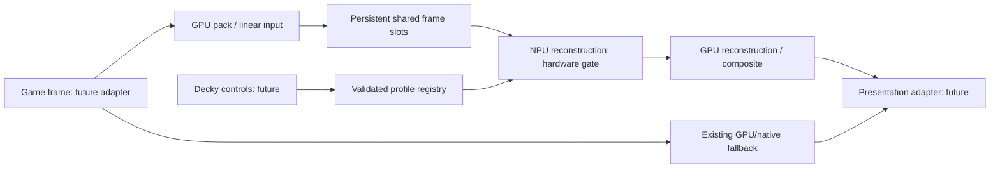

# Dock SR architecture and first milestone

Dock SR targets an opt-in Linux gaming reconstruction backend controlled by a Decky plugin. The primary target is the forthcoming Ryzen AI Z2 Extreme device. The docked destination is 1280×720 to 3840×2160 SDR; the first useful reconstruction proof remains 720p to 1080p. No target device has been tested yet.

This initial implementation provides host diagnostics, a guarded profile registry, a simulated frame scheduler, JSON contracts, and a standalone reference Vulkan compute scaler. It does not intercept games, run an NPU model, or install a Decky plugin.

The standalone baseline bypasses the game/presentation path: a deterministic CPU fixture is uploaded once, a Vulkan shader resizes its packed RGBA pixels, and readback is checked. Upload/readback and CPU reference evaluation are diagnostic work, not a claim of an optimized production pipeline.

The CPU-only `docksr-scale` command is independent of Vulkan and produces a real resized image from deterministic input or a bounded 8-bit P6 PPM. Its shared typed runtime snapshot reports CPU evidence, actual output dimensions, a completed-output count and measured CPU resize time. A 4K output canvas is not a claim of native-4K reconstructed detail. See [current decisions](DECISIONS.md) for the latest owner targets and S003→S004→S005 order.

The nearest/bilinear storage-buffer shaders are a **reference compute baseline**. In particular, manual bilinear fetch/interpolation is not the texture-sampling implementation used by an optimized Gamescope scaler. Software Vulkan validates API/shader correctness; it cannot establish competitiveness with GPU texture filters or predict AMD handheld timing.

## Profiles and simulation

Requested settings, validation state and active execution are separate. NPU profiles start disabled and unvalidated. Activation requires an exact profile revision, device/driver/runtime/model/mode/quality identity; unsupported dimensions and identifiers cannot become arbitrary execution requests. The former handoff default name is absent from its profile list, so this prototype uses the listed `probe_720_1080` identifier.

The mock backend is explicitly simulated. Its virtual times and deadline events are not physical accelerator latency or benchmark measurements. Successful mock validation cannot authorize a real NPU backend. GPU reference scaling can run independently of NPU profile activation.

A frame slot stays owned while a producer, accelerator or consumer might use it. Missing a display deadline selects fallback without freeing an outstanding writer. Resize, suspend and crash invalidate old work; a late completion cannot release a newer generation. Successful output requires consumer retirement before slot reuse. These invariants are the basis for tests, rather than a claim that real Vulkan/XRT synchronization already works.

## Hardware gates

Before real inference, identify the exact device and supported kernel/firmware/XRT/compiler combination. Then execute a supported non-identity graph and prove a persistent GPU→NPU→GPU allocation path. Buffer import, graph consumption, coherency/ownership and execution completion are independent checks. See [interop.md](interop.md).

After that, compare compact NPU detail/confidence correction plus a cheap GPU base with direct or x2 reconstruction variants. Model/operator selection, training, real async timing, game interception and Decky installation remain later work. An optional Intel laptop can help general development; its results do not validate AMD RADV/XDNA.

## Cost-saving MVP gate

A working control/plugin path is only a functional prototype. The requested MVP also needs measured lower cost than a declared existing scaler at comparable moving-image quality and matched input/output, settings and power conditions. Track real FPS, frame-time tails, frame age/input latency, CPU/GPU/NPU cost and actual whole-device power. No cost advantage or product percentage-complete is claimed by this increment.
